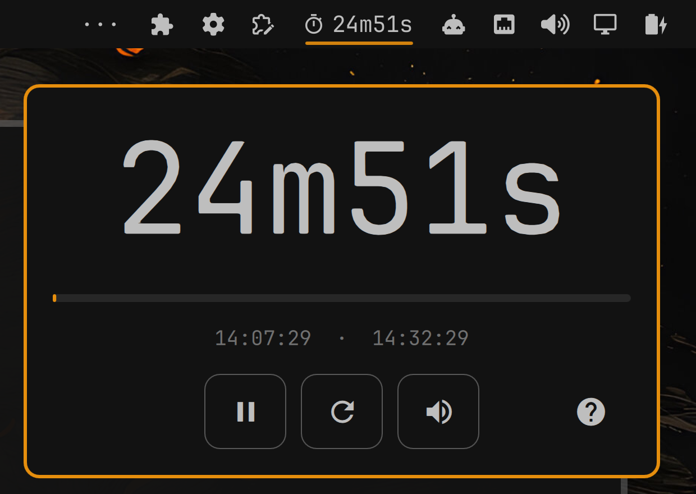

# Omatimer

A countdown timer for the Omarchy bar. Type a duration, press Enter, and the
bar counts down. When it's up you get a chime and a notification.



This is the shell-plugin version of [omatimer](https://github.com/isjake/omatimer),
the standalone Qt app. It runs inside the Omarchy shell, so there's nothing to
build and no binary to install.

## Install

```sh
omarchy plugin add https://github.com/isjake/omatimer-plugin.git --enable
```

Or find **Omatimer** in the plugin marketplace. It lands on the right of the
bar; drag it anywhere, or `omarchy bar move io.github.isjake.omatimer --section center`.

## Remove

```sh
omarchy plugin remove io.github.isjake.omatimer
rm -rf ~/.local/state/omatimer   # optional: the saved duration and settings
```

## Use

| Where | Action |
|-------|--------|
| Bar, left click | open the timer |
| Bar, right click | start or stop |
| Bar, middle click | reset |
| Enter / Space | start or stop |
| R | reset to the saved duration |
| Ctrl+M | mute (also the speaker button) |
| ? / F1 | show the shortcuts, volume and sounds |
| Esc | close |

Durations accept plain seconds (`90`) or units (`1h 30m 10s`, `1.5m`), and
the display counts down in the same notation (`1h5m30s`, `2m`, `45s`), so
whatever is on screen can be typed straight back in.

While it runs the bar shows the time left. Paused, it shows a pause mark and
dims. When it's done it says `done` until you open it.

A running timer is saved with its deadline, so it carries on through a shell
restart or a plugin update. If it ran out while the shell was down, it shows
as done without ringing late.

## From scripts and keybindings

```sh
omarchy-shell omatimer start 25m    # start, optionally with a new duration
omarchy-shell omatimer toggle       # start or stop
omarchy-shell omatimer stop
omarchy-shell omatimer reset
omarchy-shell omatimer set 1h30m    # set without starting
omarchy-shell omatimer mute
omarchy-shell omatimer open         # or close
omarchy-shell omatimer status       # e.g. "running 24m13s"
```

For example, in `~/.config/hypr/bindings.conf`:

```
bindd = SUPER ALT, T, Start a 25 minute timer, exec, omarchy-shell omatimer start 25m
```

## Sounds

Sounds play at 20% of the system volume by default; the slider under `?`
changes that. The three built-in sounds (chime, bell, click) ship with the
plugin. If the freedesktop sound theme is installed
(`sudo pacman -S sound-theme-freedesktop`), its sounds are listed too.

Playback uses `pw-play` from PipeWire, or `paplay` if that's missing. The
notification uses `notify-send`. Both come with Omarchy.

## Files

- Settings and the current timer: `~/.local/state/omatimer/plugin.json`
- Nothing else is written outside the plugin's own folder.

## Development

```sh
node tests/model.test.js          # duration parsing and formatting
python3 tools/make-sounds.py      # regenerate sounds/*.wav
omarchy plugin validate .
```

## License

MIT. See [LICENSE](LICENSE). The built-in sounds are generated by
`tools/make-sounds.py` and are covered by the same license.
