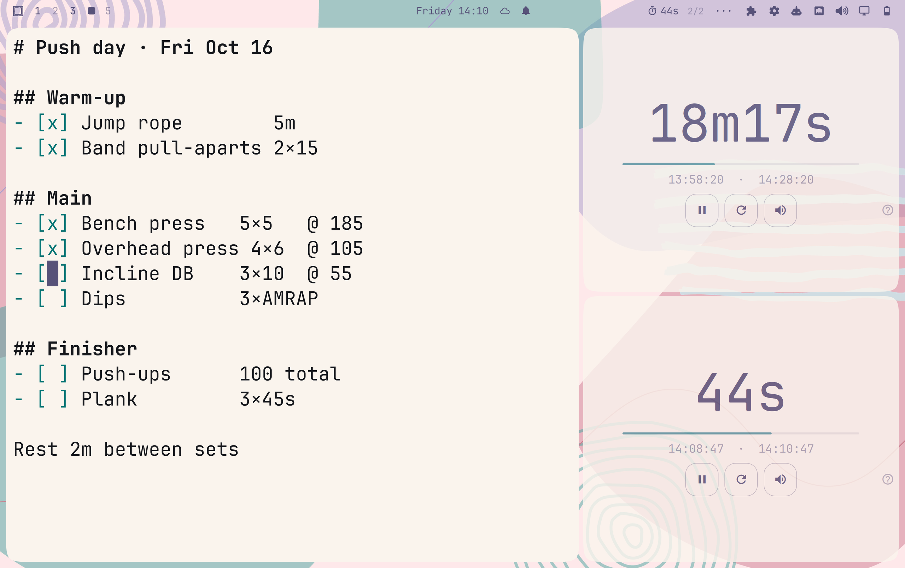

# Omatimer

A countdown timer for Omarchy. Each timer is a real window that tiles,
floats and closes like any app, or, if you prefer, a popup from the bar.
Type a duration, press Enter; when it's up you get a chime and a notification.

Listed and Verified on the [Omarchy plugin marketplace](https://plugins.omarchy.org/plugin.html?id=io.github.isjake.omatimer).


This is the shell-plugin version of [omatimer](https://github.com/isjake/omatimer),
the older standalone Qt app, which is now deprecated. It runs inside the
Omarchy shell, so there's nothing to build and no binary to install.

## Install

```sh
omarchy plugin add https://github.com/isjake/omatimer-plugin.git --enable
```

Or find **Omatimer** in the [plugin marketplace](https://plugins.omarchy.org/plugin.html?id=io.github.isjake.omatimer). Then open a timer from the
launcher (SUPER+SPACE → Omatimer) or the bar button, which lands on the right
of the bar (drag it anywhere, or remove it: it's optional).

## How timers open

Pick under **?** → *Timers*:

| Mode | What you get |
|------|--------------|
| Multiple timers, in windows (default) | every Omatimer you open is a new timer in its own window, like an app. Closing the window (Super+W) ends that timer. |
| One timer, in the bar | a popup from the bar button, as in 1.0. |

Timer windows have the class `org.quickshell` and the titles `Omatimer`,
`Omatimer 2`, and so on, so window rules match them by title. For example, to float them, in
`~/.config/hypr/hyprland.lua`:

```lua
o.window({ class = "^org\\.quickshell$", title = "^Omatimer" }, { float = true })
```

Windows live inside the Omarchy shell, so an Omarchy or plugin update
restarts them: they close and come straight back, still counting.

## Remove

```sh
omarchy plugin remove io.github.isjake.omatimer
rm -rf ~/.local/state/omatimer   # optional: saved timers and settings
```

## Use

| Where | Action |
|-------|--------|
| Bar, left click | go to the timer's window (or open one) |
| Bar, right click | start or stop it |
| Bar, middle click | reset it |
| Bar, `2/3` or scroll | cycle through your timers |
| Enter / Space | start or stop |
| R | reset to the saved duration |
| Ctrl+M | mute (also the speaker button) |
| Ctrl+N | a new timer |
| ? / F1 | show the shortcuts and settings |
| Esc | close the popup (bar mode) |

Durations accept plain seconds (`90`) or units (`1h 30m 10s`, `1.5m`), and
the display counts down in the same notation (`1h5m30s`, `2m`, `45s`), so
whatever is on screen can be typed straight back in.

While it runs the bar shows the time left. Paused, it shows a pause mark and
dims. When it's done it says `done` until you open it.

A running timer is saved with its deadline, so it carries on through a shell
restart or a plugin update. If it ran out while the shell was down, it shows
as done without ringing late.

The timers take their colors from your Omarchy theme, light or dark:



## From scripts and keybindings

```sh
omarchy-shell omatimer open         # a new timer
omarchy-shell omatimer start 25m    # a new timer, started
omarchy-shell omatimer set 1h30m    # a new timer, not started
omarchy-shell omatimer toggle       # start or stop the timer the bar shows
omarchy-shell omatimer stop
omarchy-shell omatimer reset
omarchy-shell omatimer next         # or previous: cycle the bar's timer
omarchy-shell omatimer focus        # go to the bar's timer
omarchy-shell omatimer mute
omarchy-shell omatimer settings
omarchy-shell omatimer mode windows # or bar
omarchy-shell omatimer status       # one line per timer, e.g. "running 24m13s"
```

For example, in `~/.config/hypr/bindings.lua`:

```lua
o.bind("SUPER + ALT + T", "Start a 25 minute timer", "omarchy-shell omatimer start 25m")
```

## Sounds

Sounds play at 20% of the system volume by default; the slider under `?`
changes that. The three built-in sounds (chime, bell, click) ship with the
plugin. If the freedesktop sound theme is installed (the
`sound-theme-freedesktop` package), its sounds are listed too.

Playback uses `pw-play` from PipeWire, or `paplay` if that's missing. The
notification uses `notify-send`. Both come with Omarchy.

## Files

- Settings and timers: `~/.local/state/omatimer/plugin.json`
- The launcher entry: `~/.local/share/applications/io.github.isjake.omatimer.desktop`,
  written when the plugin is enabled and removed when it's disabled or removed.
- Nothing else is written outside the plugin's own folder.

## Development

```sh
node tests/model.test.js          # duration parsing and formatting
python3 tools/make-sounds.py      # regenerate sounds/*.wav
omarchy plugin validate .
```

## License

MIT. See [LICENSE](LICENSE). The built-in sounds are generated by
`tools/make-sounds.py` and are covered by the same license.
